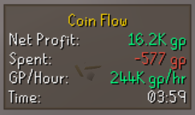
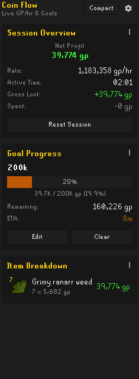

# Coin Flow

Coin Flow is a live profit and GP/hour tracker for RuneLite. It watches your inventory and equipment changes tick-by-tick to calculate what you're actually making in real time, whether you're bossing, doing slayer, skilling, sailing, or running clues.

 

## Features

- **Live Overlay & GP/hr:** Lightweight on-screen display showing your net profit, current GP/hr, session timer, and goal progress. Switch to a minimal single-line `gp/hr` style with an optional transparent background for an out-of-the-way display.
- **Net Profit Tracking:** Optionally deducts the cost of supplies you use (food bites, potion doses, ammo, runes, teleports, and jewelry that crumbles on its last charge) so you see real profit, not just raw loot value.
- **Floating Gold Drops:** Floating "+GP" drops (like XP drops) when you get loot or make money. Can appear overhead or in the top-right corner.
- **Sidebar Panel:** Session breakdown with per-item gains and losses at current GE prices, plus a quick reset button.
- **Activity Timeline:** Automatically segments your session by what you're doing — the NPC you're fighting, the skill you're training, Banking/GE, Blast Furnace, AFK — with per-activity GP/hr and, for combat, kill count, net GP per kill, and supply cost per kill. No manual "start trip" needed.
- **Goal Mode:** Set a target GP goal (e.g. `10m`, `Bond`) with a progress bar and real-time ETA based on your current rate.
- **Interface Aware:** Automatically pauses while the bank, Grand Exchange, trade screens, or storage interfaces are open, so banking and hauling never distort your stats.

## Robust Tracking

Coin Flow understands the mechanics behind the numbers; it doesn't just watch your inventory count:

- **Grand Exchange:** Reads your actual offer fills instead of guessing from inventory changes, deducts the GE tax, and remembers what you paid. Items bought this session sell against their real purchase price, and supplies you use are charged at what they cost you.
- **Shops:** Handles normal coin shops, points and reward shops, and NPC purchases made through dialogue (like Zaff's staffs) with the right rules for each.
- **Charged Weapons & Ammo:** Tridents, blowpipe, scythe, bowfa, wildy weapons and more. Charge consumption is detected from your attacks and the weapon's charge counter, then counted as supply cost.
- **Dwarf Multicannon:** Knows the difference between setting up your cannon and losing it. Parts, loaded cannonballs, pickup, and free replacements from Nulodion are all handled, so a cannon trip doesn't show fake profit or losses.
- **Skilling:** Counts materials used as a cost and the finished products as profit for smithing (including cannonballs), fletching, crafting, cooking, herblore, and more, so a training session shows its true margin.
- **Deaths:** Items lost on death are counted as a loss, reclaim fees are detected (including ironman discounts), and getting your items back from a gravestone or Death's Office cancels the loss instead of counting them as fresh loot.
- **Storage & Containers:** Banks, seed vaults, looting bags, gem bags, herb sacks, seed boxes, tackle boxes, fish barrels, log baskets, rune pouches, tool leprechauns, and ship cargo holds all work correctly. Deposits and withdrawals don't count as losses or loot.
- **Clue Caskets, Implings & Crates:** Opening a pack counts the pack itself as a cost. If you bought it this session you're charged what you paid; otherwise it uses the current market price.
- **Minigame Safe:** Items that only exist inside minigames (Castle Wars, Soul Wars, Barbarian Assault, Guardians of the Rift, Nightmare Zone, Tempoross, Last Man Standing, the Gauntlet, and more) are ignored, so a game can't show phantom profit or losses.
- **Special Worlds:** Tracking automatically pauses on Leagues, Deadman Mode, Beta, and Tournament worlds. Time spent there never skews your regular GP/hr.
- **Account Isolation:** The session resets automatically when you log into a different account, so one character's loot can't bleed into another's.

## Configuration

You can configure Coin Flow in the standard RuneLite plugin settings:
- **Display:** Toggle the overlay, pick a detailed or single-line overlay style, show or hide the overlay background, and configure side panel compact mode and gold drop styles/positions.
- **Thresholds:** Set a minimum GP value for floating gold drops so small items don't clutter the screen.
- **Supplies:** Turn supply cost deduction on or off depending on whether you want gross or net profit.
- **Ignored Items:** Add comma-separated items you don't want tracked (e.g. `Vial, Jug, Bones`).
- **AFK / Idle:** Configure how idle time affects your calculated GP/hr.

 

## Feedback & Bug Reports

If something doesn't look right or an item isn't tracked properly, please open an issue on GitHub with:
1. What activity you were doing
2. What item or interaction caused the issue
3. What the expected vs. actual result was

## License

[BSD 2-Clause License](LICENSE)
